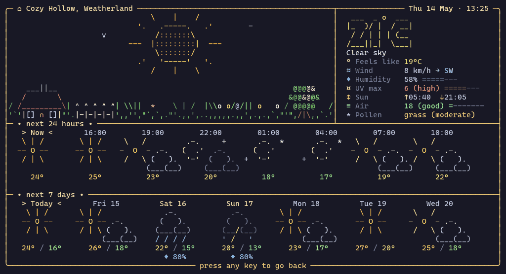

# ascii-weather

Cute animated ASCII weather for your terminal. Type `weather` and you get the current weather, the next 24 hours and the next 7 days in a fullscreen view. Press any key and you're back in your terminal, with everything that was there before.



*The demo uses made-up weather for a made-up town to show off the different scenes.*

## Install

You need Python 3.9 or newer and git.

```
pip install git+https://github.com/cweeperde/ascii-weather
```

## Updates

`weather` checks GitHub for a new version at most once a day. When there is one, you see a note with the command after closing the weather screen:

```
[notice] A new release of ascii-weather is available: 0.1.0 -> 0.2.0
[notice] To update, run: pip install --upgrade git+https://github.com/cweeperde/ascii-weather
```

Nothing is installed automatically.

## Usage

```
weather                  weather for your location
weather berlin           weather for a city
weather paris, texas     add a country or region after a comma if the city name is ambiguous
weather settings         settings menu
```

The fullscreen view shows an animated ASCII scene: a little house and a tree that changes with the seasons, with the sun moving along its arc, a crescent moon with twinkling and shooting stars, drifting clouds, fog, rain with puddles, snow, or thunderstorms. It uses only text colors, so it also looks right in terminals with a transparent background. Next to it are the current temperature, feels-like temperature, wind, humidity, UV index, sunrise and sunset, air quality and pollen, then an hourly and a 7-day forecast. In small windows it shows only the scene and the temperature.

## Settings

`weather settings` opens a menu (↑↓ to move, Enter to change, Esc to exit):

- **Home location**: a fixed city instead of detecting your location from your IP address
- **Units**: metric (°C, km/h) or imperial (°F, mph)
- **Time format**: 24h or 12h
- **Animations**: on or off

Settings are saved in `%APPDATA%\ascii-weather\config.json` (`~/.config/ascii-weather/config.json` on macOS and Linux).

## Data

- Weather, air quality, pollen and city search: [Open-Meteo](https://open-meteo.com/), free and without an API key. Pollen data is only available for Europe.
- Your location: [ipinfo.io](https://ipinfo.io/), which gets your IP address for this. If you set a home location, this lookup is skipped.

## License

[PolyForm Noncommercial 1.0.0](LICENSE.md). Copyright 2026 [cweeper](https://github.com/cweeperde). Free to use, change and share for noncommercial purposes. Project: https://github.com/cweeperde/ascii-weather
